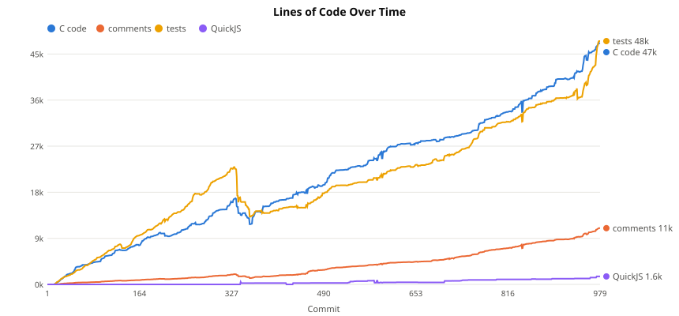

# CClaw

A minimal autonomous AI agent in C. One binary, one SQLite database file, and a sandbox around everything the agent runs. It is built for the smallest Linux machines you have: a release binary is fully static and runs on hardware as small as a 128 MB ARMv5 plug computer.

## Quick Start

From a release binary — download the one for your machine (`cclaw-linux-x64`, `cclaw-linux-arm64`, `cclaw-linux-i586` or `cclaw-linux-armv5te`) from the [releases page](https://github.com/mark-os/cclaw/releases):

```bash
chmod +x cclaw-linux-arm64 && mv cclaw-linux-arm64 cclaw
./cclaw
```

With no API key in the environment, the first run asks for one (OpenRouter, Anthropic, Gemini, Groq, Cerebras or OpenAI — it tells them apart by the key) and stores it encrypted.

From source:

```bash
export OPENROUTER_API_KEY="sk-or-v1-..."
make
./build/cclaw
```

The first run creates `~/.cclaw/` and a default agent named `Assistant`, and puts you straight into a chat. With an OpenRouter key the default model is DeepSeek V4.1 Flash, and requests are routed only to endpoints with a zero-data-retention policy. `cclaw --doctor` tells you what this host supports and what is missing.

## Architecture

All state lives in one SQLite file, `cclaw.db`: sessions, messages, config, memory, secrets and queues. One binary plays every role.

```
cclaw
├─ main thread: one poll() loop; reads a session from the database, takes the next step
├─ LLM worker threads   up to 4 by default; each keeps its own database handle and curl
│                       connection, and an idle one exits after 30 s
├─ tool threads         one short-lived thread per database-only tool call
├─ civetweb threads     daemon: dashboard, webhooks
│
├─ fork+exec → cclaw --run-tool    one per sandboxed tool call, scheduled script or hook;
│    └─ fork → sandboxed child     file tools need only the first process; web, JS and
│         ├─ net_shim              shell fork once more, add a loopback proxy, and the
│         └─ /bin/sh …             shell runs the program inside
└─ fork+exec → cclaw --channel     daemon: one long-lived runner per channel
```

**One plain loop.** The main thread runs a `poll()` loop, not a callback framework: it sleeps until the kernel says one of a handful of file descriptors has something to read, and uses no CPU while it waits. Anything slow happens elsewhere as an ordinary blocking call — a model request on a worker thread, an untrusted tool in a child process — which writes its result to the database and wakes the loop through a pipe. The loop keeps almost nothing in memory: each time it is woken for a session, it reads that session's state from the database and takes one next step. A restart picks up from what the database says. The price is that replies arrive whole rather than streamed word by word, and each slow thing needs a thread or a process of its own.

**The operating system is a friend, not an obstacle.** CClaw uses what the kernel and SQLite already do well instead of rebuilding it:

- *Isolation is a process.* Every sandboxed tool call is a fresh `fork`+`exec` of the same binary inside its own namespaces. A crash, a runaway loop or a hostile script ends that child and nothing else; the agent gets an error result and carries on.
- *A process is cheap.* Every child runs the same binary, so the kernel shares one copy of its code between them all. A new sandbox pays only for the pages it writes — a few hundred kilobytes — and starts in a few milliseconds (see [Benchmarks](#benchmarks)).
- *Concurrency is the kernel's and SQLite's job.* Threads and processes run in parallel on every core. The database uses a write-ahead log and every handle memory-maps it, so readers do not wait for the writer and all of them read the same pages from the kernel's cache. There is no lock scheme of ours to get wrong.
- *Connections are kept.* Each LLM worker reuses its open connection to the provider, so back-to-back requests skip the TLS handshake — which matters on a slow ARM board.

This has limits you can hit — an 8 MB heap for each JavaScript run, per-call timeouts, 64 KB of tool output before the rest goes to a file. They are listed, with what the agent sees, in [docs/architecture.md](docs/architecture.md#limits-you-can-hit).

**CLI mode** (default) is one process with the worker threads; no daemon needed. **Daemon mode** (`--daemon`) adds channels (Telegram, Discord, WhatsApp, webhooks), cron, the web dashboard, and many agents working at once.

## Secure

What an agent can reach is decided in two places: its **sandbox profile** (containment — what the sandbox lets a program touch) and its **grants** (authority — which tools, hosts and paths it may use). A missing grant means no. Agents ask for more with `request_config`, and a human approves — at the terminal prompt, with a button or `/approve` in a chat channel, on the dashboard, or with `cclaw approvals`. A plain yes always grants the least that works; a standing grant has to be asked for by name ("always").

- **Sandboxed tool calls** — every tool call runs in a forked child inside Linux namespaces (user, mount, network). The child sees its workspace read-write and system directories read-only; anything else needs a path grant. `cclaw.db` and `.cclaw_key` are hidden from the child under every sandboxed profile.
- **Network** — the sandbox has only a loopback interface. Programs reach the network through `HTTP_PROXY`/`HTTPS_PROXY`, which point at a proxy on that loopback. The proxy checks the agent's host allowlist (default-deny); a denied host gets a `403`, and the tool result names the blocked host. Programs that ignore the proxy variables have no network at all. `git` over ssh is preconfigured; plain `ssh` needs `-o ProxyCommand="$CCLAW_CONNECT %h %p"`.
- **Sandbox profiles** — `standard` (the default), `restricted` (no network, ever), and `host` (no sandbox at all, for machines that are already isolated or cannot run one). A sandboxed profile that cannot set up its sandbox refuses to run the tool rather than running it unsandboxed. See [specs/sandbox-profiles.md](specs/sandbox-profiles.md).
- **Secrets** — encrypted at rest in `cclaw.db` (ChaCha20-Poly1305, via Monocypher). The model refers to a secret as `{{SECRET:NAME}}`; cclaw substitutes the real value just before the tool runs, so the value never enters the context window or the logs. An agent may use only the secrets granted to it. A scanner redacts credential-shaped text from tool results and user messages.
- **Resource limits** — `setrlimit` caps the process count (and, under `restricted`, CPU time) to bound a runaway. Address space is deliberately *not* capped: `RLIMIT_AS` limits reservations rather than usage, which stops `go`/`node`/`rustc` from starting without bounding real memory.

The full model, including how the proxy and the namespaces work, is in [specs/security.md](specs/security.md).

## Portable

The goal is to run on the widest range of old, embedded and very cheap Linux devices, and later on platforms that bring their own sandbox, such as Android. CClaw is built in layers — core, tools, containment, shell, daemon — and a host that lacks what one layer needs (user namespaces, say) loses that layer and nothing below it; [specs/portability.md](specs/portability.md) describes them.

CClaw vendors everything except libcurl:

| Vendored | Purpose |
|----------|---------|
| SQLite 3.53 | All persistence, JSON, full-text search |
| QuickJS | JavaScript engine for agent-written tools, channels and scripts |
| civetweb | Embedded HTTP server |
| Monocypher | Encryption |
| jsmn, yxml | Small JSON and XML parsers |

**Release binaries** are fully static (musl, with a pinned libcurl and mbedTLS inside) for x64, arm64, i586 and armv5te. They need no shared libraries, only a CA certificate bundle on the host. See [specs/static-build.md](specs/static-build.md).

**A source build** (`make`) needs a C11 compiler and the libcurl development headers, and links the system `libcurl.so`. Use it for development and for architectures without a release binary (ARMv7, RISC-V, …).

Tested on EC2 t4g.small (arm64), Chromebooks, and a Pogoplug V4 (ARMv5TE, 128 MB RAM).

```
Release binary:  5.1–6.5 MB, static (armv5te 5.1, arm64 5.6, x64 5.8, i586 6.5)
Peak memory:     7.5 MB for a single turn with the static arm64 binary
                 (17 MB for a source build: the system libcurl and its TLS library)
Idle daemon:     12 MB resident (source build, no channels running)
```

## Self-Configuring

Agents change their own configuration through tool calls. Anything that widens what an agent can do goes to a human for approval first.

- **`search_config`** — the agent's view of itself: config keys, grants, attached extensions, and the roster of other agents.
- **`request_config`** — one *changes document* covering any mix of grants, the agent's own model list, config keys, an LLM provider, models, channel send routes, and secret host bindings. One approval covers the whole document. See [specs/config-doc.md](specs/config-doc.md).
- **`create_agent` / `update_agent`** — define and refine purpose-built agents. An agent can never create one with more reach than it has itself.
- **`launch_agent`** — hand a task to another agent, or to a worker copy of itself with a narrower tool set.

Configuration resolves in layers: `CCLAW_*` env vars override DB values, which override built-in defaults. Agents read configuration freely but write it only through these tools.

## Built-in Tools

Every new agent is granted a baseline toolset; the rest it asks for with `request_config`. More tools can be added at runtime — see [Extensible](#extensible).

| Tool | Purpose | Granted by default |
|------|---------|--------------------|
| `file_read` / `file_write` | Read a file / create or overwrite it entirely | yes |
| `file_edit` | Targeted search/replace edits — batched, matched against the original, non-overlapping | yes |
| `file_list` | List a directory (sorted alphabetically, `/` marks directories) | yes |
| `file_find` | Find files by glob (`*.c`, `src/**/*.spec.ts`) | yes |
| `file_grep` | Search file contents by POSIX regex, returns `path:line:match` | yes |
| `js_eval` | Run JavaScript in the sandboxed QuickJS engine | yes |
| `memory_block_create` / `memory_block_update` / `memory_note_add` / `memory_note_edit` / `memory_note_delete` | Manage persistent memory: named blocks holding notes addressed by id | yes |
| `search_config` / `request_config` | Read configuration / ask for changes | yes |
| `cron_set` / `cron_list` / `cron_remove` | Schedule its own prompts and scripts | yes |
| `launch_agent` / `check_session` | Delegate work and check on it | yes |
| `shell_exec` | Run a shell command in the namespace sandbox | on request |
| `web_fetch` | Fetch a URL (host-allowlisted: each new host is still a `request_config` grant); a shipped JS extension, [extensions/web-fetch](extensions/web-fetch/fetch.qjs) | yes |
| `db_query` | Query the SQLite database read-only | on request |

The baseline list is the `agent_default_tools` config key. File tools are workspace-scoped; `file_find`/`file_grep` skip `.git` and `node_modules`. `js_eval` runs modern JavaScript (QuickJS — ES2023-class; no modules, no event loop, no top-level `await`, no `Atomics`) with the globals `fs.readFile/writeFile/readdir/stat/cwd`, `http_request`, `XML.parse`, `HTML.toMarkdown`, and `LLM()` — see [specs/extensions.md](specs/extensions.md#js-dialect--globals).

## Extensible

Agents extend themselves at runtime, and QuickJS is how: C provides the peanut butter, JavaScript the jelly on top. An **extension** is the unit of sharing: a directory with an `extension.json` manifest declaring any mix of tools, a channel, scripts, skills, agents and config keys, plus the JavaScript handler files it points to. The code lives in files; the database stores only definitions and paths. The lifecycle:

1. **Draft** — the agent writes the bundle in its private workspace (`workspace/extensions/<name>/`) and tests handlers with `js_eval`. Personal skills need no bundle at all — drop a `SKILL.md` in `agents/<name>/skills/`.
2. **Promote** (`extension_promote`) — validates the manifest, and after the operator approves, copies the bundle into the shared store (`~/.cclaw/extensions/<name>/`, which agents cannot modify) and registers its contents. Still visible only to the owning agent.
3. **Publish** (`extension_publish`) / **attach** (`extension_attach`) — other agents opt in. Attaching never grants authority: tools remain subject to each agent's own grants.

The manifest is the only door from an agent's drafts to system-wide registration — one choke point where everything is validated and listed before it registers. Channels are self-contained JavaScript programs run as daemon-managed processes (Telegram, Discord and WhatsApp ship built in); extension config lands in the config registry as `<ext>.<key>`. JavaScript tools can call the agent's own model with `LLM(prompt, opts)` ([specs/js-llm.md](specs/js-llm.md)). See [specs/extensions.md](specs/extensions.md) for the authoring walkthrough.

## Self-Bootstrapping

On first run with just an API key, CClaw:

1. Creates `~/.cclaw/`, the database, and the encryption key.
2. Creates the default agent, `Assistant`, with the baseline grants (plus `create_agent`, `extension_publish`, `secret_create` and `install_service`, since it is your main point of contact), `AGENT` and `USER` memory blocks, and a disabled heartbeat cron job.
3. Starts a chat. Your request comes first; when there is room the agent works through a short setup list kept in its own memory — what to call it, who you are, a channel to reach it from your phone — deleting each step as it is done or skipped.

From there you set things up by talking to it: ask for a Telegram channel, a different model, a new agent. Anything that widens its reach comes back to you as an approval. Secrets never pass through the model: put them in the environment, store them with `cclaw secret set NAME`, or have the agent capture a tool result directly into the encrypted store with `save_secret`. A secret you add is usable by no agent until you grant it (`cclaw secret grant NAME <agent>`); one an agent captures is its own.

No manual config files. No YAML. The agent configures itself through the same tool-call interface it uses for everything else.

## Usage

```bash
cclaw                    # interactive CLI (default agent)
cclaw -p "hello"         # single-turn: print response and exit (exit 3: an approval is waiting)
cclaw approvals          # list waiting approvals; `approve <id> [once|always]`, `deny <id>`
cclaw -s 3               # resume session 3
cclaw --new              # force new session
cclaw --daemon           # daemon mode (channels, cron, multi-agent)
cclaw dashboard          # links to the daemon's web pages: /admin and /admin/data
cclaw --trust-host       # run tools without the sandbox, on a host that cannot provide one
cclaw install [--system] # set up the daemon as a systemd (or SysV init) service
cclaw --doctor           # redacted diagnostic report: TLS, layers, updates, …
cclaw update             # install the latest release (refuses one that can't open this DB)
cclaw rollback           # undo the last update: binary and DB snapshot together
cclaw backup [dest]      # consistent snapshot of the database, safe on a live daemon
cclaw resp               # the last failed LLM request and response
cclaw sqlite3 <db> "…"   # bundled SQLite shell, read-only unless --write
cclaw -v                 # debug logging (timing, context stats)
cclaw -vv                # trace logging (full LLM req/resp JSON)
cclaw version            # e.g. "cclaw v0.8.0 (1a2b3c4, 2026-11-20)"; --version is the same
cclaw --help             # all options
```

Updating, rollback and pre-release channels (`cclaw publish`) are described in [specs/operations.md](specs/operations.md).

The daemon's web pages (the dashboard at `/admin`, the data explorer at `/admin/data`) listen on `127.0.0.1:8080` by default. They are plain HTTP, so reach them from another machine through an SSH tunnel or a reverse proxy, or set `web_bind` to `0.0.0.0` on a network you trust. An admin can ask an agent for the sign-in link by sending `/admin` in a direct message.

The sandbox needs unprivileged user namespaces. Some hosts switch them off — Ubuntu 23.10 and later restrict them through AppArmor, and most containers do not allow them. cclaw says so when it starts, with the setting to change; `--trust-host` runs without the sandbox where the machine or container is already the boundary.

## Configuration

Priority (highest first):

1. `CCLAW_*` env vars
2. `~/.cclaw/cclaw.db` `config` table (registry-backed: every key ships a default + description; DB rows are overrides)

Provider API keys are resolved separately, per provider: each `providers` row
names the variable holding its key (`api_key_env`), read from the environment
first and then from the encrypted `secrets` table. `OPENROUTER_API_KEY` works
out of the box because the seeded `openrouter` row names it — it is not a
global fallback, and a provider whose key resolves nowhere is skipped by
routing rather than being tried without credentials.

```
~/.cclaw/
├── cclaw.db           ← all state
├── .cclaw_key         ← encryption key (mode 0600)
├── extensions/        ← shared extension store
└── agents/
    └── Assistant/
        └── workspace/ ← the agent's files
```

Set `CCLAW_DB_PATH` to put the database (and everything beside it) somewhere else. See [docs/configs.md](docs/configs.md).

## Building

```bash
make              # build ./build/cclaw
make smoke        # fast unit-test subset (a few seconds)
make test         # unit tests (no network)
make test-integration  # tests against mock servers
make debug        # ASan + UBSan build (clang, -O0 -g3)
make clean        # remove build/
scripts/build_static.sh arm64   # static release binary (x64|arm64|i586|armv5te)
```

## Benchmarks

Measured 2026-11-22 on an EC2 t4g.small (2 vCPU arm64, 2 GB RAM), source build, one short turn through OpenRouter to DeepSeek V4.1 Flash. Medians of 5–7 runs.

```
cclaw version:        7 ms   (process start to exit)
One turn, everything but the model:
  existing database:  43 ms  (start, context build, store the reply, exit)
  first run ever:     50 ms  (also creates the database, key and default agent)
Network and model, per request:
  DNS + TCP + TLS:    16 ms
  Time to first byte: 650 ms (model- and provider-dependent)
```

### The cost of a sandbox

Same machine, static arm64 release binary, the default `standard` profile (user, mount and network namespaces around every call).

```
One sandboxed call, from fork to result (median of 20):
  js_eval "1+1"        5.3 ms
  shell_exec "true"    4.1 ms

Memory one running sandbox adds:
  QuickJS, computing   0.9 MB  (0.4 MB private; the rest is code shared with the agent)
  shell, sleeping      0.6 MB  (0.3 MB private)

Four sub-agents each computing fib(36) in its own QuickJS sandbox, on 2 cores:
  one alone 2.6 s; four at once 5.9 s each, all finished in 6.2 s
```

Sub-agents are sessions inside the one agent process; only tool calls fork. A tool that starts a heavy program — a compiler, `node` — costs whatever that program uses on top.

## Documentation

- [docs/architecture.md](docs/architecture.md) — the full architecture: processes, threads, the main loop, how they talk, who touches the database, and the limits you can hit.
- [specs/](specs/) — the detailed reference. Start with `security.md`, `sandbox-profiles.md`, `extensions.md`, `memory.md`, `operations.md` and `schema.md`.
- [docs/](docs/) — operator how-tos: configuration, debugging, templates.
- [AGENTS.md](AGENTS.md) — project ethos, coding conventions, build instructions.
- A running agent has its own copy of the user-facing material as built-in skills it can read (the `cclaw-docs` extension, built from `templates/docs_*.md`).

## LOC



## Acknowledgements

### Vendored Libraries

| Library | License |
|---------|---------|
| [SQLite 3.53.1](https://sqlite.org) | Public Domain |
| [civetweb 1.16](https://github.com/civetweb/civetweb) | MIT |
| [QuickJS](https://bellard.org/quickjs/) | MIT |
| [Monocypher 4.0.2](https://monocypher.org) | BSD-2-Clause / CC0-1.0 |
| [jsmn](https://github.com/zserge/jsmn) | MIT |
| [yxml](https://dev.yorhel.nl/yxml) | MIT |

### Inspiration

| Project | What we learned |
|---------|-----------------|
| Pi agent | Clean agent loop, session tree model |
| OpenClaw | Autonomy features, security patterns, multi-channel integration |
| nullclaw | Architecture reference (Zig clone of OpenClaw) |
| Letta | Stateful agent design, persistent memory patterns |
| IronClaw | Secure execution model, secret injection |
| Hermes | Self-improving agent loop, skill and extension library patterns |

Special thanks to Mario Zechner and Peter Steinberger for starting the Claw movement, Igor Somov for showing what's possible in less than 1MB with NullClaw, and Rhett Creighton for insisting that I vibe code in C.
